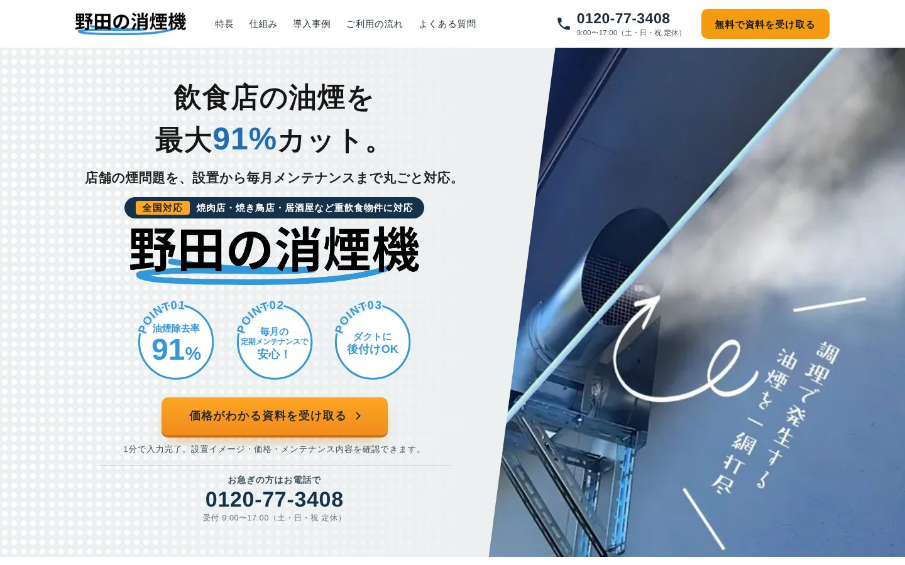

# 野田の消煙機 JL-8A — LPリニューアル

現行LP（https://shoenki.duct-noda.com/ 、WordPress + Elementor）のデザインと構成をそのまま活かし、WordPress を使わない静的サイトとして作り直したものです。
ライブラリやビルドは使わず、HTML / CSS / JavaScript だけで動きます。現行サイトにはなかった「仕組み」セクション（集塵シミュレーション）を加えました。



## プレビュー

リポジトリ直下でローカルサーバーを立てて開いてください。

```sh
python3 -m http.server 8000
# または
npx serve .
```

→ http://localhost:8000/

スクリーンショットは [`docs/preview/`](docs/preview/) にあります。撮影環境に日本語Webフォントが無いため代替フォントで表示されていますが、本番では Noto Sans JP（現行LPと同じ書体）が読み込まれます。

## 現行LPから変えたこと

色（紺 #15324a・オレンジのボタン・青 #3498db）、ロゴ、写真とイラスト、セクションの順番、文章は現行LPのままです。そのうえで、見にくい・使いにくいところを直しました。

**見やすさ**

- 本文を 16〜17px・行間 1.85 に揃えました（現行は 14px 前後で行間が詰まっていました）。
- 見出しは文節ごとに改行位置を決め、「放置し／ていませんか？」「対策で／きます。」のような変な位置での改行をなくしました。
- 背景に薄く出ていた本体の3Dモデルをやめ、文字の後ろは無地にしました。
- ファーストビューは、写真の上に文字が重なっていたのを、左に文字・右に写真の2段組みにしました。スマホでは写真の下に文字を置いています。
- 「POINT01〜03」の丸や導入店舗の帯は、画像に焼き込まれていた文字を本物の文字にしました。くっきり表示され、検索エンジンにも読まれます。
- ボタンの文字を濃い色にして、オレンジの上でも読みやすくしました。
- 導入実績の3項目は、数字を大きく見せるカードにしました。

**使いやすさ**

- スマホの左下に重なっていた「お電話」「LINE問合せ」の丸いボタンを、画面下の固定バー（お電話 / LINE / 無料で資料請求）に変えました。本文に重なりません。フォームを入力している間は自動で隠れます。
- 「スマホ表示で Loading 3D Model: 0%」の文字が出ていた問題もなくなりました。
- ヘッダーに「特長・仕組み・導入事例・ご利用の流れ・よくある質問」へのリンクを付けました（PC）。
- 稼働動画は、現行では白い箱だけが表示されていました。サムネイルと再生ボタンを表示し、押したときにだけ YouTube を読み込みます。
- よくある質問は開閉式のまま、「設置・工事」「費用・メンテナンス」「導入・ご契約」「製品・仕組み」の4つに分けました。PCでは左に分類の目次（読んでいる分類に印が付きます）と、電話・フォーム・LINEの問い合わせ欄を固定表示し、スマホでは分類ボタンを上に、問い合わせ欄を最後に置いています。答えには「A」を付け、開くときはなめらかに広がります（対応ブラウザのみ。動きを減らす設定では動きません）。
- 会社概要・プライバシーポリシー・お問い合わせは、別サイトへのリンクではなく、このサイトのページにしました（下記）。

**資料請求フォーム**

| 項目 | 現行 | リニューアル版 |
|---|---|---|
| 入力欄 | 高さ40px | 高さ52px（指で押しやすい大きさ） |
| 必須・任意 | 赤い「*」のみ | 「必須」「任意」のラベルを全項目に表示 |
| 同意のチェック | 13pxの小さなチェックボックス | 押しやすい大きさの枠に変更 |
| 資料請求の目的 | プルダウン | タップで選べるボタン（初期値は「情報収集」のまま） |
| 入力ミス | ブラウザ標準の吹き出し | 項目の下に日本語で表示し、最初の誤りへ移動。全角の英数字・＠は自動で半角に直す |
| 自動入力 | なし | ブラウザの自動入力（会社名・都道府県・氏名・メール・電話）に対応 |
| 店舗の所在地 | なし | 都道府県を選ぶ欄を追加（全国販売に向けて、通知メールの件名に都道府県が入ります） |
| 迷惑送信 | — | 人には見えない入力欄で機械的な送信を除外 |
| 送信後 | サンキューページ（`/transmission/`）へ移動 | 資料請求は今と同じサンキューページ（`/transmission/`、届かない場合の案内・電話番号つき）へ移り、そこで Google タグマネージャーに `generate_lead` イベントを送信。お問い合わせは同じページに完了画面を表示 |
| 計測 | — | 広告の流入元（utm_～ / gclid）と参照元を一緒に送信 |

## 全国販売に向けて

九州・中国地方に限らず全国で販売するため、地域が限られて見える表現を見直しました。

- 導入店舗の帯から地域名（福岡・熊本）を外し、業態だけにしました。九州以外の方が「九州限定」と受け取らないようにするためです。
- ファーストビューの帯に「全国対応」を加えました。
- よくある質問に「対応エリアはどこまでですか？」を加えました（13問）。質問には地域名を出さず、答えで「全国に対応」「九州・中国地方以外では提携業者が設置工事と毎月のメンテナンスを担当」と説明しています。
- 「ご利用の流れ」の下に、同じ内容の注記を入れました。
- 資料請求とお問い合わせのフォームに「店舗の所在地（都道府県）」を加えました。
- 説明文（meta description）と構造化データ（対応エリア：日本）に全国対応を反映しました。

## 販売のみの表記（2026年10月18日）

代理店での販売を進めるため、LPではレンタルを案内せず、販売（買取）だけを載せる方針になりました。レンタルは当社の直販でのみ扱い、資料はレンタルあり版と販売のみ版に分けます。

- ファーストビューの POINT03 を「導入しやすい料金プラン」から「ダクトに後付けOK」に、「選ばれる理由」の3つ目を「大がかりな改修なしで後付けOK」に変えました。
- 特長4点の「購入・レンタル どちらも対応」を「後付け 既存店舗にも設置OK」に変えました。
- よくある質問の「どんなプランがありますか？（購入とレンタルの2種類）」を「導入費用はどのくらいかかりますか？」に変え、本体価格・標準工事・毎月のメンテナンス費用は資料で、正式な金額は現地調査のうえでお見積り、と答えています。
- 資料請求ボタンを「料金プランつき資料を受け取る」から「価格がわかる資料を受け取る」に、「資料でわかること」を「本体価格・工事費用」にしました。お問い合わせページと自動返信メールの「料金プラン」も「価格」にしています。
- LPの資料請求で送る資料は販売のみ版で、自動返信メールには Box の共有リンク（2026年10月18日にご提供）を設定しています（`DOWNLOAD_URL`）。

## 会社概要・プライバシーポリシー・お問い合わせ

| ページ | 内容 |
|---|---|
| `company/` | 会社情報（商号、代表者、設立、本社所在地、広島出張所、電話・FAX・フリーダイヤル、メール、事業内容、対応エリア、ウェブサイト）。会社サイトの会社概要に合わせています |
| `privacypolicy/` | 会社サイトのプライバシーポリシーをもとに、個人情報保護法で公表が必要な項目（具体的な利用目的、安全管理措置と外国のクラウドの利用、開示・利用停止などの請求、事業者の住所・代表者）と、このサイトで実際に預かる情報（フォームの参照元・広告の情報、LINE の表示名）を書き足したもの |
| `contact/` | お問い合わせフォーム（種類・店名・都道府県・お名前・メール・電話・内容）と、電話・LINEの案内。フォームの先頭と送信後の表示、受付確認メールで「このフォームでは資料は届かない。資料は資料請求フォームから」と案内 |

- 会社情報は会社サイト（duct-noda.com/company/、2026年10月14日に確認）の会社概要に合わせました。事業内容には、このサイトで扱う消煙機の販売・設置・メンテナンスを足しています。会社サイトには資本金・許可番号の記載はありません。
- 会社サイトの見出しまわりには、広島出張所の古い住所（佐伯区）がまだ残っています。会社概要の表は安佐南区です。
- 会社サイトのプライバシーポリシーには、上の項目が足りていません。会社サイトも同じ文面にそろえることをおすすめします。
- ヘッダーとフッターは4ページそれぞれに書いています。電話番号などを変えるときは、4ファイルとも直してください。

## 表示速度

| | 現行LP | リニューアル版 |
|---|---|---|
| 最初に読み込むデータ量 | 16MB 以上（3Dモデル 15.5MB、three.js、jQuery、Elementor ほか） | 約 0.3MB（Webフォントを除く） |
| リクエスト数 | 約120 | 約17 |
| JavaScript（計測タグを除く） | 約25ファイル | 1ファイル（19KB、後から読み込み） |
| レイアウトのずれ（CLS） | — | 0 |

- 画像はすべて WebP に変換し、画面幅に合った大きさを読み込みます。ファーストビューの写真は先読みし、それ以外は表示直前に読み込みます。
- Webフォント（Google Fonts）は表示を止めずに後から読み込みます。

## SEO

- タイトルは現行LPと同じ「【油煙91%カット】野田の消煙機│飲食店の排煙トラブルをゼロへ」です。
- 説明文（meta description）は、現行の「独自フィルターで」を取扱説明書どおり「電気集塵方式で」に直しました。
- canonical、OGP（1200×630 の共有用画像 `assets/img/ogp.jpg` を新しく作成）、`robots.txt`、`sitemap.xml` を用意しました。
- WordPress から差し替えるときは、`.htaccess` で WordPress 時代のURL（`/野田の消煙機/` など）をトップページへ301転送し、検索の評価を引き継ぎます。存在しないURLには `404.html`（検索エンジンには載せない設定）を出します。
- 構造化データ（JSON-LD）：会社情報（Organization）、製品（Product）、よくある質問（FAQPage、13問）。下層ページにはパンくず（BreadcrumbList）。
- 見出しは h1 を1つにして、各セクションを h2・h3 で整理しました。画像にはすべて代替テキストがあります。
- 計測タグは現行LPと同じもの（Google タグマネージャー GTM-W7PSRQTX と、Site Kit が入れていた Google タグ GT-MJJR4XTD）を入れています。資料請求とお問い合わせの完了時に `generate_lead` イベントを送ります。資料請求の完了ページは今と同じ `/transmission/` なので、このページの表示で広告の成果を数えている場合も、そのまま数えられます。

## 掲載情報について（取扱説明書を優先）

現行LPの文章をもとにしつつ、取扱説明書（消煙機 JL-8A 取扱説明書）と食い違う箇所は取扱説明書に合わせました。

| 項目 | 現行LP | リニューアル版（取扱説明書に準拠） |
|---|---|---|
| 消費電力 | 500W | **500W**（取扱説明書は300Wですが、今後販売する製品は500Wとのことで、こちらに合わせました） |
| 電気代の目安 | 月2,500円程度 | **月2,500円程度**（500W × 1日6〜7時間 × 月25日 × 31円/kWh で再計算） |
| 除去の仕組み | meta説明文に「独自フィルター」 | **電気集塵方式**（高電圧部12kV＋低電圧部6kV） |
| 性能の確認 | 出力電圧を実測 | 出力電圧の正常値（12kV±2kV / 6kV±2kV）を追記 |
| フィルター交換 | 継続購入は不要 | 継続購入は不要。ただし「長期使用で劣化した部品（電極・ガイシなど）は交換が必要な場合あり」と追記 |
| 設置スペース | 本体前後にチャンバーボックスとメンテナンススペース | 正面0.7m以上のメンテナンススペースと明記 |

よくある質問に「屋外にも設置できますか？」「保証はありますか？」（取扱説明書より）を加えました。全国対応の質問とあわせて13問です。

## 公開の手順（コアサーバーの WordPress と差し替える）

今のLP（shoenki.duct-noda.com）は、コアサーバー（LiteSpeed）の WordPress で動いています。同じサーバー・同じURLのまま、公開フォルダの中身を WordPress から新しいファイルに入れ替えます。DNS（ドメインの向き先）は変えず、SSL（https）もそのまま使えるので、検索順位もそのまま引き継がれる見込みです。作業にはコアサーバーのコントロールパネル（またはFTP）に入れる方が必要です。

**事前準備（今のサイトはそのまま）**

1. **フォームは設定なしで使えます**（下の「フォームの送信先」）。送信元は今の WordPress のフォームと同じ info@duct-noda.com にしてあります。
2. **アップロードするファイルをそろえる**：`index.html` `404.html` `.htaccess` `robots.txt` `sitemap.xml` と、フォルダ `assets/` `company/` `contact/` `privacypolicy/` `transmission/` `form/` です。`v2/` `wordpress/` `docs/` `README.md` `_headers` は上げません。`.htaccess` は名前が「.」で始まるので、パソコンでは隠しファイルになっていることがあります。
3. **広告の成果の数え方はそのままで大丈夫です**：資料請求の送信後は、今と同じサンキューページ（`/transmission/`）に移ります。広告や Google アナリティクスで、このページの表示を成果として数えている場合も、設定を変えずに数えられます。
4. **試しに置いて確かめる（おすすめ）**：公開フォルダの中に `_new` フォルダを作って 2. のファイルを入れ、`https://shoenki.duct-noda.com/_new/` で表示と、フォームのメール（自動返信と通知）が届くかを確かめます。表示されれば `.htaccess` もこのサーバーで動いています（動かない場合もエラーになるのはそのフォルダだけで、今のサイトには影響しません）。確認できたらフォルダごと削除します。

**差し替え（今のサイトが新しいLPに変わります。日時はご判断ください）**

5. **バックアップを取る**：公開フォルダの中身をすべてパソコンにダウンロードし、WordPress のデータベースも書き出して（コントロールパネルの phpMyAdmin、またはバックアップ用プラグイン）保存します。
6. **WordPress のファイルを公開フォルダの外へ移す**：ファイルマネージャーか FTP で、公開フォルダの中身を、公開フォルダの外に作ったフォルダ（例：`wp_backup_20261020`）へ移動します。削除ではなく移動にしておくと、すぐに戻せます。
7. **新しいファイルをアップロードする**：2. のファイルを公開フォルダに入れます。`.htaccess` は WordPress のものと置き換わります。
8. **すぐに確認する**
   - トップ・会社概要・プライバシーポリシー・お問い合わせが表示される。`http://` で開くと `https://` に変わる
   - 資料請求とお問い合わせを1件ずつ送り、自動返信と通知メールが届くかを確かめる（迷惑メールのフォルダも）
   - 稼働動画がその場で再生される
   - 資料請求の送信後に「資料のご請求ありがとうございます」のページ（`/transmission/`）が出る
   - 旧URL（例：`/elementor-768/`）がトップページに移り、存在しないURLでは「ページが見つかりません」が出る
   - タグマネージャーのプレビューか、GA4 のリアルタイムで計測が届いている

   表示がおかしい場合は、新しいファイルを消して 6. で移したファイルを戻せば元どおりです。「リダイレクトが多すぎます」と出る場合は、`.htaccess` の https への転送（`RewriteCond %{HTTPS}` からの3行）を消してください。

**差し替えのあと**

9. **Search Console**：「サイトマップ」に `sitemap.xml` を送信し、トップページを「URL検査 → インデックス登録をリクエスト」します。旧サイトマップ（`sitemap.rss` など）は新しい `sitemap.xml` に転送されます。
10. **WordPress を片付ける**：1〜2か月問題がなければ、移しておいた WordPress のファイルとデータベースを削除します。使わない WordPress を置いたままにすると、更新されずに攻撃の入口になりやすいためです。バックアップはパソコンに残しておきます。

**`.htaccess` でしていること**：`http://` から `https://` への転送、WordPress 時代のURL（`/野田の消煙機/` `/elementor-768/` `/投稿1/`〜`/投稿3/` `/category/お知らせ/` `/feed/` など）からトップページへの転送（301）、旧サイトマップから `sitemap.xml` への転送、公開しないフォルダを見せない設定、存在しないURLで `404.html` を表示、セキュリティとキャッシュのヘッダー。

Cloudflare Pages・Netlify などに移す場合は `.htaccess` の代わりに `_headers` が使われ、DNS の切り替えが必要になります。PHP が動かないので、フォームの送信先も別に用意する必要があります。

## フォームの送信先

資料請求（`index.html`）とお問い合わせ（`contact/index.html`）のフォームは、同じサーバーの [`form/send.php`](form/send.php) に送られます。WordPress のフォームと同じく、コアサーバーから直接メールを送るので、Google などの外部サービスの設定は要りません（PHP が動くサーバーなら動きます）。送るメールは次の2通です。

1. 担当者への通知メール（件名は「【野田の消煙機LP】資料請求がありました［福岡県］○○ 様」の形で、本文にも消煙機のLPのどのフォームから来たかを書きます。返信するとお客様に届きます）
2. お客様への自動返信メール（資料請求は Box のダウンロードリンク、お問い合わせは受付確認と「資料はお送りしていません」の案内）

設定はファイル先頭にまとめてあり、すべて設定済みです。通知先（`NOTIFY_TO`）は info@noda-duct.com・koroyasu@duct-noda.com・azuma@duct-noda.com・nagamizu@duct-noda.com の4件、お客様からの返信先（`REPLY_TO`）は info@noda-duct.com、資料のURL（`DOWNLOAD_URL`）は Box の共有リンクです。送信元（`FROM_EMAIL`）は、今の WordPress のフォームと同じ info@duct-noda.com です（2026年10月18日にご提供）。

いたずら対策として、ほかのサイトからの送信は受け付けず、同じ接続元からの送信は10分間に5件までにしています。`data-endpoint` を空にすると「プレビュー」として完了画面だけを表示し、実際には送信しません（チェック用のプレビューはこの状態です）。

## 公開前に確認していただきたいこと

- **会社ドメイン**：取扱説明書のメール・Webは `noda-duct.com`、現行LPのリンク先は `duct-noda.com` です。検索結果では両方のサイトが出てきます。会社概要のウェブサイト欄は `duct-noda.com` にしています。
- **全国対応の表現**：「全国対応」と、よくある質問の答え（設置とメンテナンスの進め方は地域ごとにご案内）を、実際の体制に合わせて確認してください。
- **実績の数字**：「導入店舗の99%がクレーム減少を実感」「全国100軒以上」「清掃頻度が月1回から3ヶ月に1回」は現行LPの記載をそのまま使っています。
- **フッターの会社情報**：住所・電話は取扱説明書の記載（株式会社野田、福岡市博多区東月隈3-5-4）です。
- **3Dモデル**：表示速度を優先して外しました（現行の背景に出ていた本体の3D表示）。
- **計測**：WordPress の Site Kit が入れていた Google タグ（GT-MJJR4XTD）を直接入れています。タグマネージャー側でも同じ GA4 を設定している場合は二重計測になるので、どちらか一方にしてください。

## ページ構成

| セクション | 内容 |
|---|---|
| ファーストビュー | キャッチコピー、ロゴ、POINT01〜03、資料請求ボタン、電話番号。右に排気ダクトの写真 |
| 導入店舗の帯 | 導入店舗の写真と業態が流れる帯 |
| お悩み | 「飲食店の“煙問題”を放置していませんか？」、番号つきの街並みの挿絵、4つのお悩み。カードにカーソルを合わせると、挿絵の同じ番号が大きくなる |
| 特長（紺） | 「まとめて対策できます」、本体写真、特長4点（PCとタブレットは2×2）、稼働動画。スマホでは見出し→写真→特長→動画の順 |
| **仕組み（追加）** | 電気集塵の3ステップ（整える → 12kVで帯電 → 6kVで集める）。煙の粒が集まる様子をスクロールに合わせて表示し、集塵率が最大91%まで上がる |
| 3つのメリット | 近隣クレーム・外壁の油汚れ・物件の価値 |
| 選ばれる理由（紺） | 毎月の定期メンテナンス、20年以上の実績、大がかりな改修なしで後付けOK |
| 導入事例 | 焼肉店・居酒屋・焼き鳥店の課題 → 導入 → 結果 |
| 導入店舗の実績（紺） | 99% / 100軒以上 / 3ヶ月に1回 |
| ご利用の流れ | 5ステップ。番号を1本の線でつなぎ、スクロールに合わせて線が伸びて番号が点灯する（動きを減らす設定の端末では、最初から全部点灯） |
| よくあるご質問（紺） | 13問を4分類、問い合わせ欄つき |
| 資料請求 | フォーム、電話、LINE |

## ファイル構成

```
index.html
company/ privacypolicy/ contact/   会社概要・プライバシーポリシー・お問い合わせ
assets/
  css/site.css
  js/site.js          ヘッダー / 導入店舗の帯 / 動画 / 集塵シミュレーション / フォーム（資料請求・お問い合わせ）
  img/                写真・イラスト・ロゴ・favicon・OGP（WebP）
  img/ticker/         導入店舗の帯の写真
404.html              見つからないページ（WordPress 時代の古いURLなど）で出すページ
transmission/         資料請求のサンキューページ（今のサイトと同じURL。検索エンジンには載せない設定）
.htaccess             コアサーバー用の設定（https への転送、旧URLの転送、ヘッダー）
robots.txt / sitemap.xml / _headers
form/send.php         フォームの送信先（通知メールと自動返信をこのサーバーから送る PHP）
docs/preview/         スクリーンショット（docs/preview/v2/ は前回のデザイン案）
v2/                   前回お見せしたデザイン案（参考用・検索エンジンには載せない設定）
wordpress/            現行サイト（WordPress + Elementor）に「仕組み」だけを載せる部品
```

## 現行サイト（WordPress）への部分移植

[`wordpress/elementor-shikumi.html`](wordpress/elementor-shikumi.html) は「仕組み」セクションだけを、現行サイトの Elementor に載せるための部品です。中身をすべて HTML ウィジェットに貼り付けると動きます。静的サイトへ移行する場合は不要です。

- 固定ヘッダーの高さ（WordPress の管理バーを含む）は自動で読み取ります。ずれる場合は `<section class="nesp" data-offset="70">` のように指定できます。
- スクロールに合わせた固定表示ができない場合は、3つの段階を自動で繰り返し再生します。
- シミュレーションの中身は `assets/js/site.js` と同じです。どちらかを直したら、もう一方も合わせてください。

## 画像

- 写真・イラスト・ロゴは現行LPから取得し、WebP に変換して軽くしました。
- お悩みの挿絵（煙が隣のマンションに届く焼肉店の街並み）は、HTMLに直接書いた SVG です。4つのお悩みと同じ番号を振っています。煙が排気口から出続けてマンションへ流れ、住人が「ゴホッ」と咳き込み、店主は手紙を手にため息をつき、洗濯物やちょうちんが揺れます（CSS アニメーション。画面に見えている間だけ動き、動きを減らす設定の端末では止まった絵になります）。以前のお悩みの人物イラストは、この挿絵に置き換えました。
- 「特長」の本体写真（`assets/img/jl8a-1000.webp` / `jl8a-600.webp`、5:4）は、2026年10月15日にご提供いただいた本体画像（パンフレットの仕様ページと同じもの）です。背景はそのまま使い、本体の上下左右が切れないよう中央に寄せて切り出しています。
- LINE のボタンには、LINE の公式アイコン（`assets/img/line-icon.webp`）を使っています。
- フッターのロゴは、現行LPと同じく青地にそのまま載せる版（`assets/img/logo-footer.webp`、下線を白にしたもの）です。
- 会社ロゴ（株式会社野田の「N」マーク、2026年10月18日にご提供）は、全ページのフッターの社名の前と、会社概要の「商号」に入れています。ページ内に直接描いているので、色はフッターでは白、会社概要では黒です。検索エンジン向けの会社情報（構造化データ）のロゴには `assets/img/noda-logo.png`（512×512）を使っています。faviconとホーム画面アイコンは、もともと同じマークです。
- 導入店舗の帯の写真は、現行LPの帯画像から写真部分を切り出したもので解像度が低めです。元の写真があれば差し替えます。

## 実装メモ

- 依存ライブラリなし。集塵シミュレーションは Canvas 2D で描いています。
- `prefers-reduced-motion`（動きを減らす設定）では、導入店舗の帯を止め、集塵シミュレーションはゆっくり動かします。
- 見出しは文節ごとに `<span class="nb">` で区切り、スマホでも単語の途中で改行しないようにしています（`word-break: auto-phrase` 非対応の Safari 向け）。
